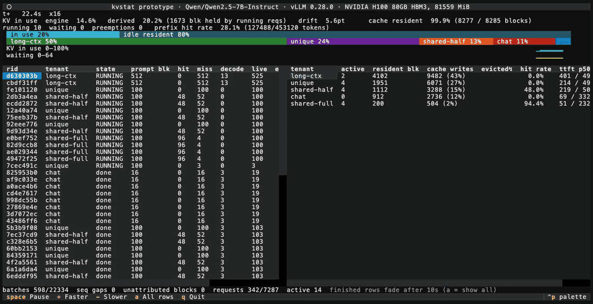

# kvstat

**See inside vLLM's KV cache, request by request.**



*Prototype playing back a recorded session at 16× speed: vLLM 0.28.0, Qwen2.5-7B-Instruct on one H100, five request classes, a preemption storm.*

kvstat attaches to a running [vLLM](https://github.com/vllm-project/vllm) server and shows what is happening inside its KV cache right now: which requests hold which blocks, which ones are hitting the prefix cache, which one was just preempted, and why TTFT spiked when it happened. Dashboards show the totals; kvstat shows the requests behind them.

It rebuilds this view from vLLM's KV cache event stream (`--kv-events-config`), the same stream KV-aware routers rely on, and keeps cross-checking it against vLLM's own Prometheus metrics. When the two disagree, the screen flags it, so you always know how much to trust what you see.

## What v1 shows

- **KV occupancy map** — who holds how many blocks, how fragmented the pool is, how much headroom is left.
- **Prefix-cache attribution** — which prompt prefixes requests share, how much of the cache goes to prompts nobody reuses, and when a shared prefix had to be computed again.
- **Pressure** — KV usage, queue depth, evictions and preemptions over time, with TTFT when the engine reports it.
- **Status bar with error bounds** — state age, reconcile drift, dropped batches.
- **Record & play back** — capture the event stream to a file, open it in the TUI later.

Not a benchmark, autotuner, router, or Grafana replacement. Single vLLM instance first.

## Usage

Start vLLM with KV events on, then watch its KV cache and record it in one go:

```bash
vllm serve <model> --kv-events-config '{"enable_kv_cache_events": true, "publisher": "zmq", "replay_endpoint": "tcp://*:5558"}'
kvstat top --replay-endpoint tcp://127.0.0.1:5558 --out run.jsonl.gz
```

You watch the cache live, and `run.jsonl.gz` keeps the session to replay or summarize later.
Drop `--out` to only watch.

The screen leads with one sentence that names the current state. Below it: the pool as one bar,
split into blocks running requests hold, idle cached blocks and free blocks; the last minutes of
scheduler pressure, with in use, waiting, evictions, preemptions and TTFT each on its own row;
the prefixes the cache holds now, one row per stretch of blocks that requests share, with how
many requests use it, its share of the cache and how often it was computed again in the last
minute, and one row for the blocks only one request uses; and a status bar that says how far
to trust the screen. The status bar shows kvstat's health, the last scrape that contradicted
it, gaps and resyncs on the stream, and which metrics this engine reports. A row the engine
does not report is left out, not drawn flat.

To record without a screen, for example in tmux or as a sidecar:

```bash
kvstat record --replay-endpoint tcp://127.0.0.1:5558 --out run.jsonl.gz
```

The capture keeps the raw event batches, so any later kvstat can read it. Add
`--redact-tokens` before sharing one: events carry prompt token ids.

Give `record` the replay socket. Started again on the same file, `record` continues it and asks
vLLM for the batches it missed, so an interruption leaves no hole. Without the replay socket a
dropped connection loses every batch sent meanwhile, and kvstat says so at startup. Pass
`--overwrite` to start a capture over instead of continuing it.

Play a capture back — no GPU and no server needed:

```bash
kvstat top --from run.jsonl.gz --speed 4
```

Space pauses, `+` and `-` change the speed, `q` quits. Or print the summary instead:

```bash
kvstat report --from run.jsonl.gz
```

```
Qwen/Qwen2.5-7B-Instruct  ·  vLLM 0.28.0  ·  8,285 blocks x 16 tokens

engine in use    0.0% - 100.0%   peak 8,281 blocks
prefix cached    8,262 / 8,285 (99.7%)   free 23
turnover         every 7.1s   1,166 blocks/s stored, 1,166 evicted
lifetime         p50 9.4s   p95 12.4s
prefix re-stores 0   (needs kv_cache_report_mode: full on the workload)
kvstat           ok  ·  0 rebuild(s)  ·  230 orphan stores  ·  119.9s
drift            ok  (119 polls)
```

*Prefix cached* counts the blocks in the prefix cache, idle ones included. *Engine in use* is
vLLM's own `kv_cache_usage_perc`, and it counts something else: the blocks that running requests
hold right now. The event stream says nothing about when a request lets a block go, so kvstat
shows both numbers and derives neither from the other. At every scrape it checks that the two
stay in a relationship the engine cannot break. `drift` is that verdict.

## Development

```bash
uv sync
uv run kvstat --help
uv run pytest
```

## License

Apache-2.0. See [LICENSE](LICENSE).
